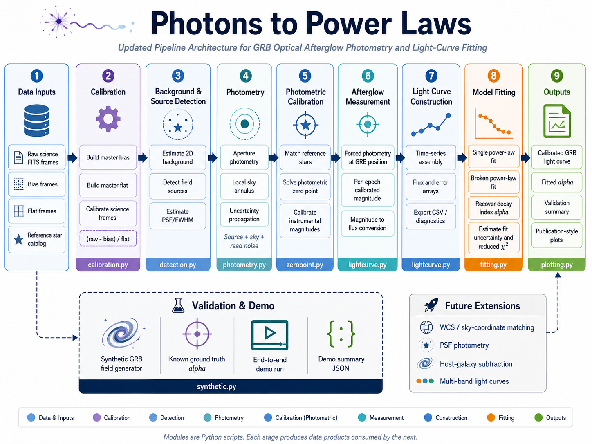

<div align="center">

# Photons to Power Laws

### From raw telescope frames to the physics of gamma-ray burst afterglows

[](https://github.com/Harishik/photons-to-power-laws/actions/workflows/ci.yml)

[](LICENSE)
[](https://github.com/astral-sh/ruff)


</div>

**Photons to Power Laws** is a Python pipeline that takes optical images of a
gamma-ray burst (GRB) afterglow and turns them into physics. It calibrates raw
frames, measures the seeing, calibrates photometry against a reference star
catalog through the WCS, forces photometry at the burst position, fits single
and broken power laws jointly across bands, and tests the fitted slopes against
the closure relations of the fireball model to infer the electron energy index,
the circumburst medium, and the jet break.

It is validated two ways: on a simulated campaign where the true physics is
known, and on **public ZTF images of GRB 221009A**, the brightest gamma-ray
burst ever recorded, where it is checked against published photometry.

## Results

### Simulated campaign: injected physics recovered from raw pixels

The demo simulates 36 dithered g/r/i frames with variable seeing and
transparency, saturating stars, a structured bias, and a vignetted flat. The
injected afterglow has `p = 2.2` in a constant-density medium with a jet break
at half a day. Everything below is recovered from the raw FITS files.

<picture>
  <source media="(prefers-color-scheme: dark)" srcset="docs/figures/lightcurve_dark.png">
  
</picture>

| Parameter | Injected | Recovered |
|---|---:|---:|
| Early decay, alpha1 | 0.900 | 0.901 ± 0.001 |
| Late decay, alpha2 | 2.200 | 2.206 ± 0.043 |
| Spectral index, beta | 0.600 | 0.600 ± 0.007 |
| Jet-break time | 0.500 d | 0.501 ± 0.011 d |
| Electron index, p | 2.2 | 2.200 ± 0.013 |
| Preferred model | broken power law | broken power law (ΔBIC = 15,209) |

The closure-relation test picks the injected regime on its own: an ISM in the
`nu_m < nu < nu_c` regime before the break and a post-jet-break decay after it.

<p align="center">
<picture>
  <source media="(prefers-color-scheme: dark)" srcset="docs/figures/closure_dark.png">
  
</picture>
</p>

### Real data: GRB 221009A in public ZTF images

The same `reduce_frame` code runs on 120″ ZTF cutouts of GRB 221009A,
calibrated against Pan-STARRS1, with the flux in the deep pre-burst ZTF
reference image subtracted. The afterglow is detected at 1.6, 3.6 and 5.6 days
in r band; later epochs give forced-photometry limits. One epoch is rejected
after inspection because a satellite trail crosses the aperture.

<picture>
  <source media="(prefers-color-scheme: dark)" srcset="case_studies/grb221009a/figures/lightcurve_dark.png">
  
</picture>

| Measurement | Value |
|---|---|
| Decay index from ZTF alone (t ≥ 1 d) | 1.53 ± 0.15 |
| Decay index from ZTF + Liverpool Telescope | 1.40 ± 0.02 |
| Published r′ decay after 0.4 d (Laskar et al. 2023) | 1.42 ± 0.01 |
| ZTF − Liverpool at the detected epochs | +0.10 to +0.24 mag (ZTF fainter) |

<picture>
  <source media="(prefers-color-scheme: dark)" srcset="case_studies/grb221009a/figures/filmstrip_dark.png">
  
</picture>

The full write-up, including what limits the measurement, is in
[`case_studies/grb221009a`](case_studies/grb221009a/README.md).

## How it works

<p align="center">
  
</p>

<picture>
  <source media="(prefers-color-scheme: dark)" srcset="docs/figures/pipeline_stages_dark.png">
  
</picture>

| Stage | Module | What it does |
|---|---|---|
| Calibration | `calibration` | Sigma-clipped master bias and flats; `(raw − bias) / flat` |
| Detection | `detection` | Background and RMS maps, DAOFIND detection, seeing from Gaussian fits to isolated stars, source masks |
| Photometry | `photometry` | Vectorised aperture photometry; sky from masked, sigma-clipped annuli; CCD-equation errors |
| Calibration to AB | `zeropoint` | One-to-one WCS cross-match; robust weighted zero point with optional colour term |
| Reduction | `pipeline` | Seeing-matched apertures, per-frame zero point, astrometric correction, forced photometry at the burst |
| Light curve | `lightcurve` | Multi-band light curve in flux density, so faint and negative forced fluxes are kept |
| Fitting | `fitting` | Single and smoothly broken power laws, joint across bands with spectral index beta; AIC/BIC comparison |
| Physics | `closure` | Ranks the closure relations against the measured (alpha, beta) and infers `p` |
| Data | `synthetic`, `archives` | Simulated campaigns with known truth; ZTF (IRSA) and Pan-STARRS1 (MAST) access |

Photometric calibration is solved separately for every frame, and the
recovered zero points track the simulated atmosphere:

<picture>
  <source media="(prefers-color-scheme: dark)" srcset="docs/figures/zeropoints_dark.png">
  
</picture>

## Quickstart

```bash
git clone https://github.com/Harishik/photons-to-power-laws.git
cd photons-to-power-laws
python -m venv .venv && source .venv/bin/activate
pip install -e .
```

Run the validation demo (simulate, reduce, fit, validate, draw figures):

```bash
p2pl demo --out my_demo
```

Fit your own light curve (CSV with `time_s` and `flux_ujy`/`flux_err_ujy`, or `mag`/`mag_err`, and an optional `band` column):

```bash
p2pl fit my_lightcurve.csv --plot fit.png
```

Reproduce the GRB 221009A case study from the committed ZTF data:

```bash
python case_studies/grb221009a/analyze.py
```

## Python API

```python
from glob import glob

from astropy.coordinates import SkyCoord
from astropy.table import Table

from grb_afterglow import (
    build_master_bias,
    build_master_flat,
    compare_models,
    evaluate_closure_relations,
    fit_lightcurve,
    run_pipeline,
)
from grb_afterglow.calibration import load_fits


def frames(pattern):
    return [load_fits(path)[0] for path in sorted(glob(pattern))]


bias = build_master_bias(frames("raw/bias_*.fits"))
flats = {band: build_master_flat(frames(f"raw/flat_{band}_*.fits"), master_bias=bias) for band in "gri"}
catalog = Table.read("catalog.csv")  # ra, dec, and per-band AB magnitudes (g, g_err, r, r_err, ...)
target = SkyCoord(150.10330, 22.39806, unit="deg")

result = run_pipeline(sorted(glob("raw/sci_*.fits")), target, catalog, master_bias=bias, master_flats=flats)
lc = result.lightcurve

single = fit_lightcurve(lc, "single", reference_band="r")
broken = fit_lightcurve(lc, "broken", reference_band="r")
print(compare_models(single, broken).summary())

p, e = broken.params, broken.errors
best = evaluate_closure_relations(p["alpha2"], e["alpha2"], p["beta"], e["beta"])[0]
print(f"{best.relation.label}: p = {best.p:.2f} ± {best.p_err:.2f}")
```

`p2pl simulate my_data` writes a simulated campaign in exactly this layout (run the snippet inside `my_data/`).

## Repository layout

```text
src/grb_afterglow/      the package (pipeline stages, fitting, closure relations, plots, CLI)
tests/                  70 tests: unit, statistical error-bar checks, end-to-end recovery
case_studies/grb221009a fetch_data.py, analyze.py, committed public data, results, figures
examples/synthetic/     demo outputs: light curve, per-frame table, validation summary
docs/                   science background, figures, architecture diagram
scripts/run_demo.py     regenerates the demo outputs and README figures
```

## Testing and quality

```bash
pip install -e ".[dev]"
pytest --cov          # 70 tests
ruff check . && ruff format --check .
```

Beyond unit tests, the suite checks that the error bars are honest: forced
photometry on blank sky averages to zero with unit-width pulls, repeated noise
realisations match the quoted uncertainties, and an end-to-end run recovers the
injected afterglow physics. CI runs on Python 3.10 to 3.13 and also runs the
demo and the case study.

## Scope and roadmap

The pipeline does aperture photometry with reference-flux subtraction. For
faint afterglows on bright hosts or in crowded fields, the next steps are:

- [ ] PSF photometry (`photutils.psf`)
- [ ] Image subtraction against the reference image
- [ ] Colour terms between instrument and catalog bandpasses in `reduce_frame`
- [ ] Galactic and host extinction corrections, so beta can be measured on real data
- [ ] Bayesian (MCMC) fitting for posterior distributions of the break time and `p`
- [ ] More case studies from public archives

## Documentation

- [Science background](docs/science_background.md): afterglows, closure relations, jet breaks, extinction
- [GRB 221009A case study](case_studies/grb221009a/README.md)
- [Changelog](CHANGELOG.md) · [Contributing](CONTRIBUTING.md) · [Citation](CITATION.cff)

## Citation

If this project helps your work, please cite it using [`CITATION.cff`](CITATION.cff):

```bibtex
@software{jamwal_photons_to_power_laws,
  author  = {Jamwal, Harishik Dev Singh},
  title   = {Photons to Power Laws: an optical photometry pipeline for gamma-ray burst afterglows},
  year    = {2026},
  version = {0.2.0},
  url     = {https://github.com/Harishik/photons-to-power-laws},
}
```

## Acknowledgements

Built on [Astropy](https://www.astropy.org/) and
[photutils](https://photutils.readthedocs.io/). The case study uses public data
from the Zwicky Transient Facility via the NASA/IPAC Infrared Science Archive
and from Pan-STARRS1 via MAST, and Liverpool Telescope photometry published by
Laskar et al. (2023); see
[`case_studies/grb221009a/data`](case_studies/grb221009a/data/README.md) for
full acknowledgements.

Released under the [MIT License](LICENSE).
