<div align="center">

# Photons to Power Laws

### From raw telescope frames to the physics of gamma-ray burst afterglows

[](https://github.com/Harishik/photons-to-power-laws/actions/workflows/ci.yml)

[](LICENSE)
[](https://github.com/astral-sh/ruff)

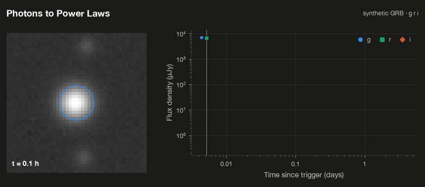

</div>

**Photons to Power Laws** is a Python pipeline that takes optical images of a
gamma-ray burst (GRB) afterglow and turns them into physics. It calibrates raw
frames, measures the seeing, calibrates photometry against a reference star
catalog through the WCS, subtracts a deep template image to remove the host
galaxy and blended stars, measures the burst with empirical-PSF or aperture
photometry with colour-term zero points, and corrects for Milky Way and host
dust. It then fits single and broken power laws jointly across bands and
instruments, through each instrument's filter curve, and samples their
posterior. The fitted slopes are tested against the closure relations of the
fireball model to infer the electron energy index, the circumburst medium and
the jet break. Physical blast-wave models (`afterglowpy`) can be fitted too,
and full CCD frames are handled with a PSF and subtraction kernel that vary
across the field.

It is validated three ways: on a simulated campaign where the true physics is
known, and on public ZTF images of two real bursts, checked against published
results: **GRB 221009A**, the brightest gamma-ray burst ever recorded, seen
through four magnitudes of Galactic dust, and **GRB 210204A**, an afterglow
ZTF discovered itself and followed in three bands.

## Results

### Simulated campaign: injected physics recovered from raw pixels

The demo simulates 36 dithered g/r/i frames with variable seeing and
transparency, saturating stars, a structured bias, a vignetted flat, and an
r = 21 host galaxy under the afterglow, plus a deep template image per band.
The injected afterglow has `p = 2.2` in a constant-density medium with a jet
break at half a day. Each frame is template-subtracted and measured with PSF
photometry; everything below is recovered from the raw FITS files.

<picture>
  <source media="(prefers-color-scheme: dark)" srcset="docs/figures/lightcurve_dark.png">
  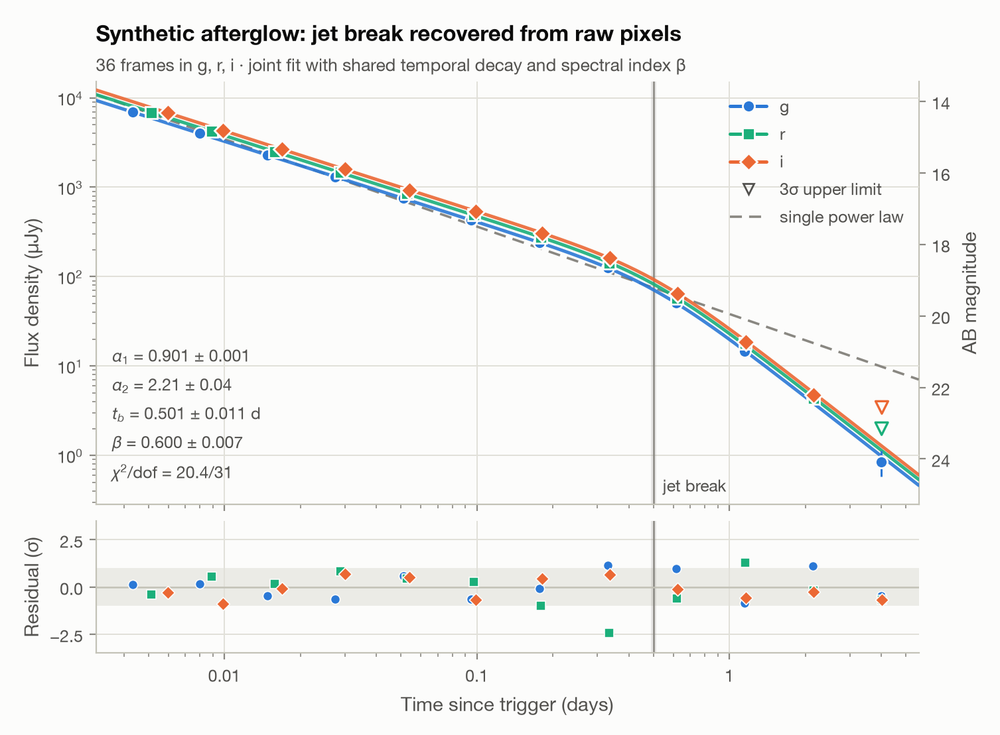
</picture>

| Parameter | Injected | Recovered |
|---|---:|---:|
| Early decay, alpha1 | 0.900 | 0.901 ± 0.001 |
| Late decay, alpha2 | 2.200 | 2.187 ± 0.038 |
| Spectral index, beta | 0.600 | 0.608 ± 0.006 |
| Jet-break time | 0.500 d | 0.494 ± 0.011 d |
| Electron index, p | 2.2 | 2.216 ± 0.012 |
| Preferred model | broken power law | broken power law (ΔBIC = 17,041) |

Every parameter is within 1.4σ of the injected value. The host galaxy is why
image subtraction matters: measured the simple way, with apertures on the
science frames, the same data give `alpha2 = 1.34 ± 0.01`, a 70σ error,
because once the afterglow fades below the host the aperture measures the host.

<picture>
  <source media="(prefers-color-scheme: dark)" srcset="docs/figures/host_comparison_dark.png">
  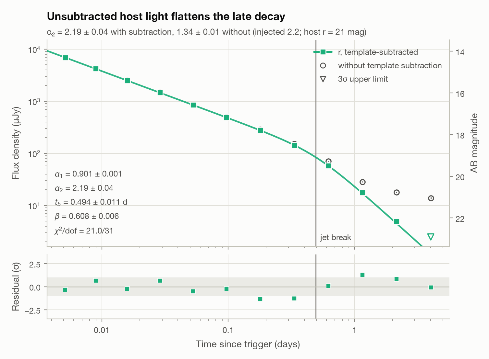
</picture>

<picture>
  <source media="(prefers-color-scheme: dark)" srcset="docs/figures/subtraction_dark.png">
  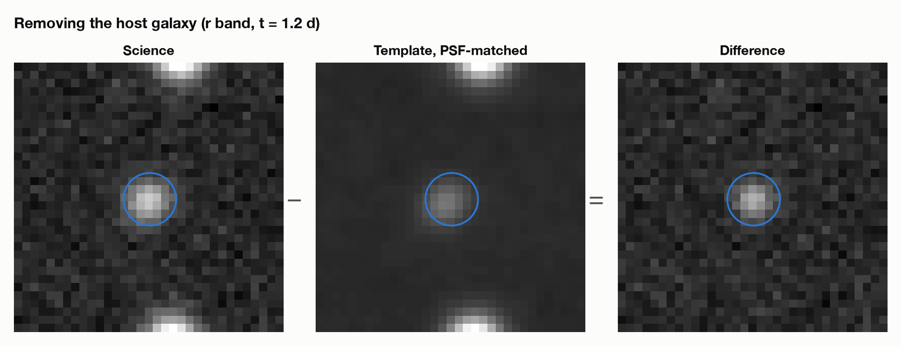
</picture>

The closure-relation test picks the injected regime on its own: an ISM in the
`nu_m < nu < nu_c` regime before the break and a post-jet-break decay after it.
The posterior, sampled with MCMC, agrees with the least-squares errors here,
where the data constrain every parameter well, and shows the correlation
between the break time and the late decay that a jet-break fit always has.

<p align="center">
<picture>
  <source media="(prefers-color-scheme: dark)" srcset="docs/figures/closure_dark.png">
  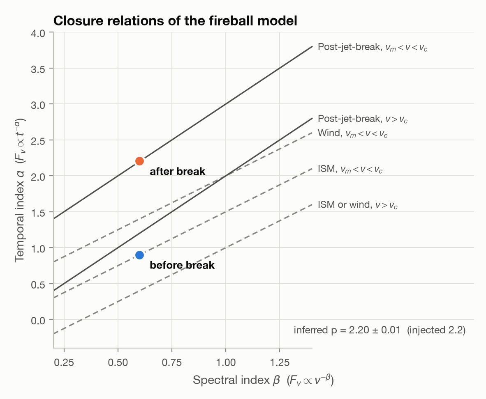
</picture>
</p>

<p align="center">
<picture>
  <source media="(prefers-color-scheme: dark)" srcset="docs/figures/posterior_dark.png">
  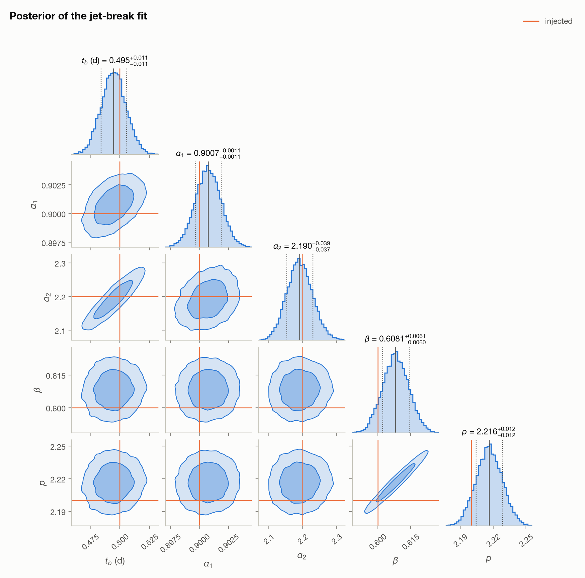
</picture>
</p>

### Real data: GRB 221009A in public ZTF images

The same `reduce_frame` code runs on 120″ ZTF cutouts of GRB 221009A,
calibrated against Pan-STARRS1. The deep pre-burst ZTF reference image is
subtracted from every epoch and the afterglow is measured on the difference
image with PSF photometry. It is detected at 1.6, 3.6, 5.6 and 10.6 days in
r band; later epochs give forced-photometry limits. One epoch is rejected
after inspection because a satellite trail crosses the aperture.

<picture>
  <source media="(prefers-color-scheme: dark)" srcset="case_studies/grb221009a/figures/lightcurve_dark.png">
  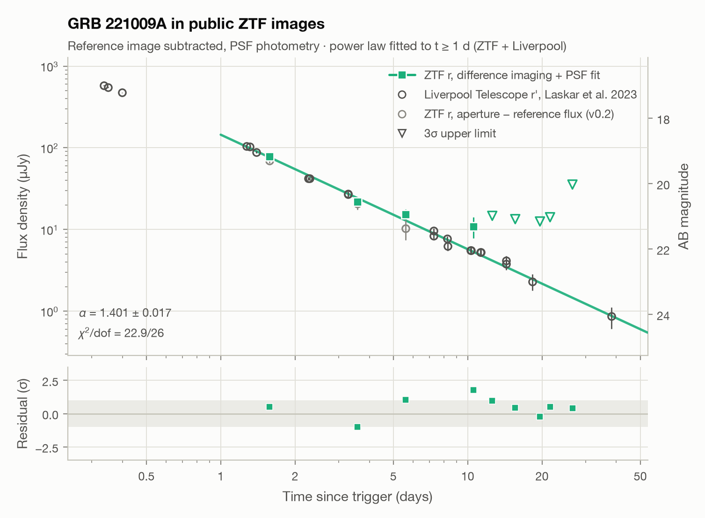
</picture>

| Measurement | Value |
|---|---|
| Decay index from ZTF alone (t ≥ 1 d) | 1.34 ± 0.09 |
| Same, v0.2 method (aperture minus reference flux) | 1.53 ± 0.15 |
| Decay index from ZTF + Liverpool Telescope | 1.40 ± 0.02 |
| Published r′ decay after 0.4 d (Laskar et al. 2023) | 1.42 ± 0.01 |
| ZTF − Liverpool at the first three detections | −0.03, +0.11, −0.19 mag |
| Spectral index, optical + near-infrared from four instruments (1.7 to 20 d) | 0.66 ± 0.03 (stat) ± 0.13 (dust) ± 0.05 (system) |
| Published optical/IR spectral index (O'Connor et al. 2023) | 0.68 ± 0.05 |

Difference imaging with PSF photometry raises the signal-to-noise of each
detection by a factor of 1.4 to 1.9 over the v0.2 measurement and shrinks the
error on the ZTF-only decay index by 40 %. Both agree with the published value.
The Galactic dust removes 4.7 magnitudes in g and 0.5 in Ks, so the spectral
index is fitted to Liverpool, Lowell and Gemini photometry from g to Ks at
once:

- the dust is forward-modelled through each instrument's filter curve;
- each band has a calibration offset with a prior.

From Liverpool's griz alone, beta comes out 0.46 or 0.91 depending on which
photometric system the published magnitudes are assumed to be in. The near
infrared shrinks that ambiguity to 0.66 against 0.76, in agreement with the
published value.

The ZTF zero points use a colour term measured once from all frames, because
the afterglow is far redder than the calibration stars.

<p align="center">
<picture>
  <source media="(prefers-color-scheme: dark)" srcset="case_studies/grb221009a/figures/sed_dark.png">
  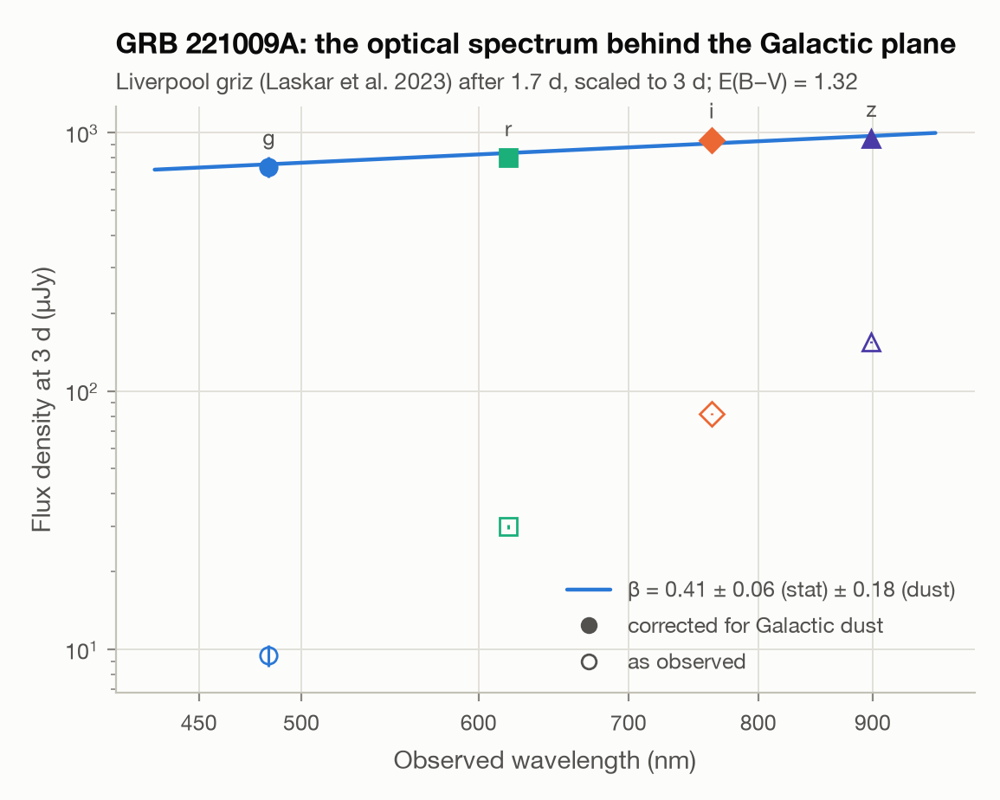
</picture>
</p>

<picture>
  <source media="(prefers-color-scheme: dark)" srcset="case_studies/grb221009a/figures/subtraction_dark.png">
  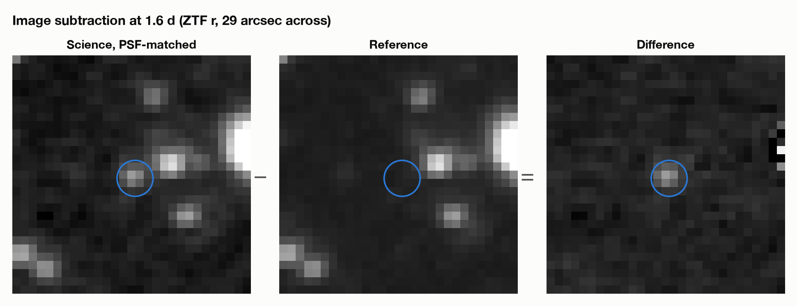
</picture>

<picture>
  <source media="(prefers-color-scheme: dark)" srcset="case_studies/grb221009a/figures/filmstrip_dark.png">
  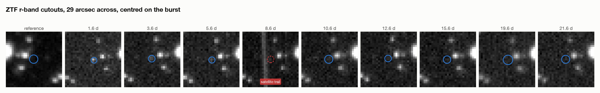
</picture>

The full write-up, including what limits the measurement, is in
[`case_studies/grb221009a`](case_studies/grb221009a/README.md).

### Real data: GRB 210204A, a jet break in three ZTF bands

ZTF imaged GRB 210204A 38 minutes after the Fermi trigger and kept observing
in g, r and i for a month. Far from the Galactic plane (E(B−V) = 0.028), the
three bands measure the spectral index directly. The joint jet-break fit lands
on the same physics Kumar et al. (2022) found with ZTF and several other
telescopes: a constant-density medium and an electron index near 2.5.

<picture>
  <source media="(prefers-color-scheme: dark)" srcset="case_studies/grb210204a/figures/lightcurve_dark.png">
  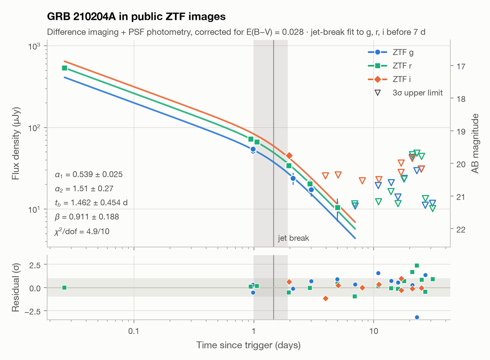
</picture>

| ZTF only, this pipeline (68 % intervals) | | Kumar et al. (2022) |
|---|---:|---:|
| Break time | 0.95 ± 0.88 d (two modes) | 0.37 ± 0.30 d |
| Late decay, alpha2 | 1.28 +0.47 −0.16 | 1.18 ± 0.03 |
| Spectral index, beta | 0.93 ± 0.19 | ≈ 0.75 (optical to X-ray) |
| Closure relation | ISM, slow cooling, p = 2.86 ± 0.38 | ISM, p ≈ 2.5 |

With a single ZTF epoch before the break, the posterior has two modes:

- a break between 1 and 2 days;
- a break right after that first epoch, which leaves the early decay
  unconstrained.

MCMC does not converge on that shape, and least squares sees only the first
mode. The posterior is therefore integrated on a grid of break time and early
decay index.

A physical top-hat jet model (`afterglowpy`) was also fitted, with Kumar et
al.'s density and epsilon_B held fixed. From the ZTF light curve alone it
gives their electron index (2.16 against 2.18) and jet opening angle (0.022
against 0.024 rad). With epsilon_B free as well, densities held about 50 times
apart (10⁻⁵·⁶⁷ and 10⁻⁴ cm⁻³) fit equally well, a degeneracy that only X-ray
and radio data break.
The write-up is in [`case_studies/grb210204a`](case_studies/grb210204a/README.md).

### Full CCD frames

The same GRB 210204A epoch, reduced on the whole 3072 × 3080 ZTF quadrant
instead of a cutout (`PipelineConfig(photometry="psf", tiles=(4, 4))`):

- the PSF varies smoothly across the frame;
- the subtraction kernel is fitted per tile;
- 4,650 Pan-STARRS1 stars set the zero point instead of 6.

The afterglow comes out at 68.4 ± 4.4 µJy, against 67.9 ± 3.8 µJy from the
cutout. The PSF FWHM varies by 3 % over the quadrant, and static stars cancel
better with tiled kernels than with one (rms χ 1.09 against 1.14). See
[`dev/full_frame`](dev/full_frame/README.md).

## How it works

<picture>
  <source media="(prefers-color-scheme: dark)" srcset="docs/assets/architecture_dark.png">
  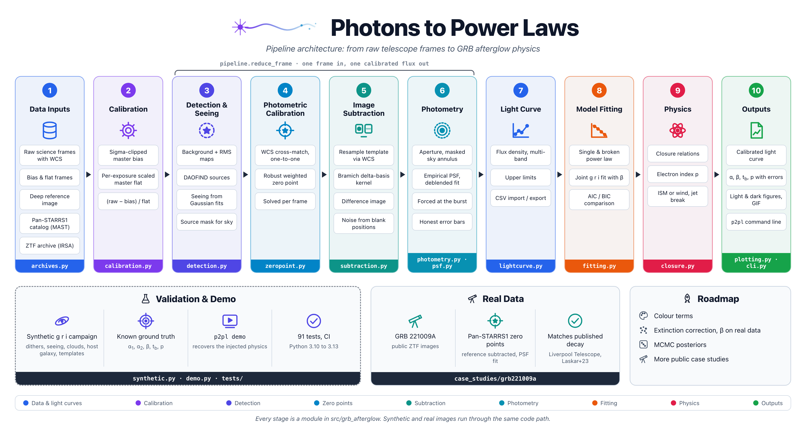
</picture>

<picture>
  <source media="(prefers-color-scheme: dark)" srcset="docs/figures/pipeline_stages_dark.png">
  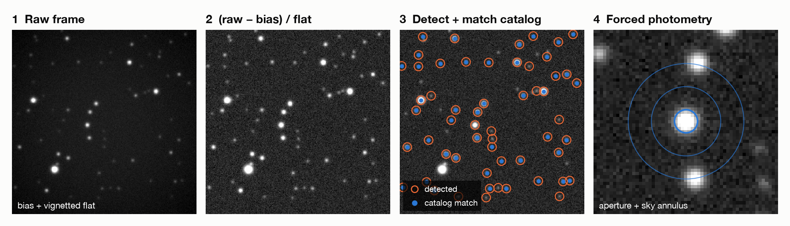
</picture>

| Stage | Module | What it does |
|---|---|---|
| Calibration | `calibration` | Sigma-clipped master bias and flats; `(raw − bias) / flat` |
| Detection | `detection` | Background and RMS maps, DAOFIND detection, seeing from Gaussian fits to isolated stars, source masks |
| Calibration to AB | `zeropoint` | One-to-one WCS cross-match; robust weighted zero point; colour terms, fitted or fixed, evaluated at the burst's colour |
| Image subtraction | `subtraction` | Template resampled through the WCS; Bramich (2008) delta-basis kernel with errors-in-variables correction, regularisation and clipping, optionally per tile and interpolated across a full frame; difference image in science counts |
| Photometry | `photometry`, `psf` | Aperture photometry with masked, sigma-clipped sky annuli and CCD-equation errors; empirical PSF (Moffat + oversampled residual) fitted to all sources at once, or varying across a full frame; forced PSF fits on difference images with errors from blank positions |
| Reduction | `pipeline` | Seeing-matched apertures, per-frame zero point, astrometric correction, template subtraction, forced photometry at the burst |
| Light curve | `lightcurve` | Multi-band light curve in flux density, so faint and negative forced fluxes are kept |
| Filters | `filters`, `spectral` | 35 system transmission curves (ZTF, Pan-STARRS1, SDSS, Liverpool, Gemini, Palomar, 2MASS, HST) from the SVO Filter Profile Service; synthetic photometry of a power law behind dust through any of them |
| Extinction | `extinction` | Milky Way (Cardelli et al. 1989) and SMC-like host (Pei 1992) curves; corrections averaged over filter transmission curves; afterglow colours |
| Fitting | `fitting`, `mcmc` | Single and smoothly broken power laws, joint across bands and instruments: spectral index, Galactic dust forward-modelled through each filter curve, optional host A_V, calibration offsets with priors; AIC/BIC comparison; posteriors with `emcee` or on a grid |
| Physics | `closure`, `physical` | Ranks the closure relations against the measured (alpha, beta) and infers `p`; fits physical jet models with `afterglowpy` (optional) |
| Data | `synthetic`, `archives` | Simulated campaigns with known truth; ZTF (IRSA) and Pan-STARRS1 (MAST) access |

Photometric calibration is solved separately for every frame, and the
recovered zero points track the simulated atmosphere:

<picture>
  <source media="(prefers-color-scheme: dark)" srcset="docs/figures/zeropoints_dark.png">
  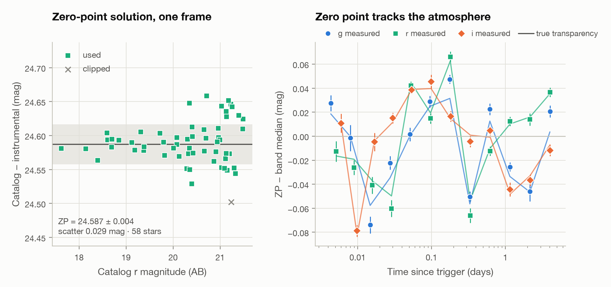
</picture>

## Quickstart

```bash
git clone https://github.com/Harishik/photons-to-power-laws.git
cd photons-to-power-laws
python -m venv .venv && source .venv/bin/activate
pip install -e .              # or ".[models]" to fit physical afterglow models with afterglowpy
```

Run the validation demo (simulate, reduce, fit, validate, draw figures):

```bash
p2pl demo --out my_demo
```

Fit your own light curve (CSV with `time_s` and `flux_ujy`/`flux_err_ujy`, or `mag`/`mag_err`, and an optional `band` column):

```bash
p2pl fit my_lightcurve.csv --plot fit.png
```

Reproduce the GRB 221009A case study from the committed ZTF data:

```bash
python case_studies/grb221009a/analyze.py
```

## Python API

```python
from glob import glob

from astropy.coordinates import SkyCoord
from astropy.table import Table

from grb_afterglow import (
    PipelineConfig,
    build_master_bias,
    build_master_flat,
    compare_models,
    evaluate_closure_relations,
    fit_lightcurve,
    run_pipeline,
)
from grb_afterglow.calibration import load_fits


def frames(pattern):
    return [load_fits(path)[0] for path in sorted(glob(pattern))]


bias = build_master_bias(frames("raw/bias_*.fits"))
flats = {band: build_master_flat(frames(f"raw/flat_{band}_*.fits"), master_bias=bias) for band in "gri"}
catalog = Table.read("catalog.csv")  # ra, dec, and per-band AB magnitudes (g, g_err, r, r_err, ...)
target = SkyCoord(150.10330, 22.39806, unit="deg")

result = run_pipeline(
    sorted(glob("raw/sci_*.fits")),
    target,
    catalog,
    master_bias=bias,
    master_flats=flats,
    templates={band: f"templates/template_{band}.fits" for band in "gri"},  # optional: difference imaging
    config=PipelineConfig(photometry="psf"),  # or "aperture" (the default)
)
lc = result.lightcurve

single = fit_lightcurve(lc, "single", reference_band="r")
broken = fit_lightcurve(lc, "broken", reference_band="r")
print(compare_models(single, broken).summary())

p, e = broken.params, broken.errors
best = evaluate_closure_relations(p["alpha2"], e["alpha2"], p["beta"], e["beta"])[0]
print(f"{best.relation.label}: p = {best.p:.2f} ± {best.p_err:.2f}")
```

Photometry from several telescopes goes into one fit by naming each band after
its filter curve (`grb_afterglow.filters.available_filters()` lists them):

```python
joint = fit_lightcurve(
    combined,  # a LightCurve with bands such as "lt:r", "ztf:g", "f2:Ks"
    "single",
    reference_band="lt:r",
    ebv_mw=1.32,  # Galactic dust, applied to the model through every filter curve
    calibration_offsets={"ztf": 0.03, "f2": 0.05},  # zero-point offsets (mag) with Gaussian priors
)
print(joint.params["beta"], joint.offsets)
```

A physical model of the jet (with `pip install -e ".[models]"`):

```python
from grb_afterglow.physical import AfterglowModel, fit_afterglow, sample_afterglow

model = AfterglowModel(redshift=0.876, jet="tophat", ebv_mw=0.028)
jet = fit_afterglow(lc, model, ["log10_E0", "theta_core", "p"], fixed={"log10_n0": -2.0, "log10_eps_B": -2.0})
posterior = sample_afterglow(lc, jet)
```

Full CCD frames, whose seeing changes across the field, take
`PipelineConfig(photometry="psf", tiles=(4, 4))`: the PSF varies smoothly over
the frame and the subtraction kernel is fitted per tile. With the default
aperture photometry, `tiles` affects only the subtraction kernel.

`p2pl simulate my_data` writes a simulated campaign in exactly this layout (run the snippet inside `my_data/`).

## Repository layout

```text
src/grb_afterglow/      the package (pipeline stages, fitting, closure relations, plots, CLI)
tests/                  126 tests: unit, statistical error-bar checks, end-to-end recovery
case_studies/grb221009a ZTF case study behind the Galactic plane: fetch_data.py, analyze.py, data, results, figures
case_studies/grb210204a three-band ZTF case study with a jet break and late flares, and a physical jet model
examples/synthetic/     demo outputs: light curve, per-frame table, validation summary
docs/                   science background, figures, architecture diagram (make_architecture.py)
dev/bakeoff/            harness and results of the PSF-photometry and image-subtraction method comparison
dev/full_frame/         a full 3072 x 3080 ZTF quadrant with a PSF and kernel that vary across the frame
scripts/run_demo.py     regenerates the demo outputs and README figures
scripts/fetch_filters.py rebuilds the filter curves in src/grb_afterglow/data/filters from the SVO service
```

## Testing and quality

```bash
pip install -e ".[dev,models]"
pytest --cov          # 126 tests
ruff check . && ruff format --check .
```

Beyond unit tests, the suite checks that the error bars are honest: forced
photometry on blank sky averages to zero with unit-width pulls, repeated noise
realisations match the quoted uncertainties, PSF fluxes are unbiased with
unit-width pulls, image subtraction cancels static stars and the host while
keeping the transient's flux in both seeing directions, and an end-to-end run
recovers the injected afterglow physics. CI runs on Python 3.10 to 3.13 and also runs the
demo and both case studies.

## Scope and roadmap

Done: PSF photometry and image subtraction (0.3); colour terms, Milky Way and
host extinction, MCMC posteriors and a second case study (0.4); and in 0.5:

- [x] Spatially varying PSF and kernel, for full CCD frames rather than cutouts
- [x] Cross-calibration of several instruments into one light curve
- [x] Physical afterglow models (`afterglowpy`) fitted alongside power laws
- [x] Near-infrared data, so the spectral index is less sensitive to dust

Possible next steps: X-ray and radio data in the physical fits, which would
break the degeneracy between energy, density and magnetic field that optical
data leave; and nested sampling for multimodal posteriors.

## Documentation

- [Science background](docs/science_background.md): afterglows, closure relations, jet breaks, image subtraction, PSF photometry, extinction
- [GRB 221009A case study](case_studies/grb221009a/README.md) · [GRB 210204A case study](case_studies/grb210204a/README.md)
- [Changelog](CHANGELOG.md) · [Contributing](CONTRIBUTING.md) · [Citation](CITATION.cff)

## Citation

If this project helps your work, please cite it using [`CITATION.cff`](CITATION.cff):

```bibtex
@software{jamwal_photons_to_power_laws,
  author  = {Jamwal, Harishik Dev Singh},
  title   = {Photons to Power Laws: an optical photometry pipeline for gamma-ray burst afterglows},
  year    = {2026},
  version = {0.5.0},
  url     = {https://github.com/Harishik/photons-to-power-laws},
}
```

## Acknowledgements

Built on [Astropy](https://www.astropy.org/) and
[photutils](https://photutils.readthedocs.io/). The case studies use public data
from the Zwicky Transient Facility via the NASA/IPAC Infrared Science Archive
and from Pan-STARRS1 via MAST, Liverpool Telescope photometry published by
Laskar et al. (2023), and Lowell, Gemini, Palomar and HST photometry published
by O'Connor et al. (2023); see
[`case_studies/grb221009a/data`](case_studies/grb221009a/data/README.md) for
full acknowledgements. This research has made use of the SVO Filter Profile
Service "Carlos Rodrigo", funded by MCIN/AEI/10.13039/501100011033/ through
grant PID2023-146210NB-I00 (Rodrigo et al. 2012, 2020, 2024).

Released under the [MIT License](LICENSE).
