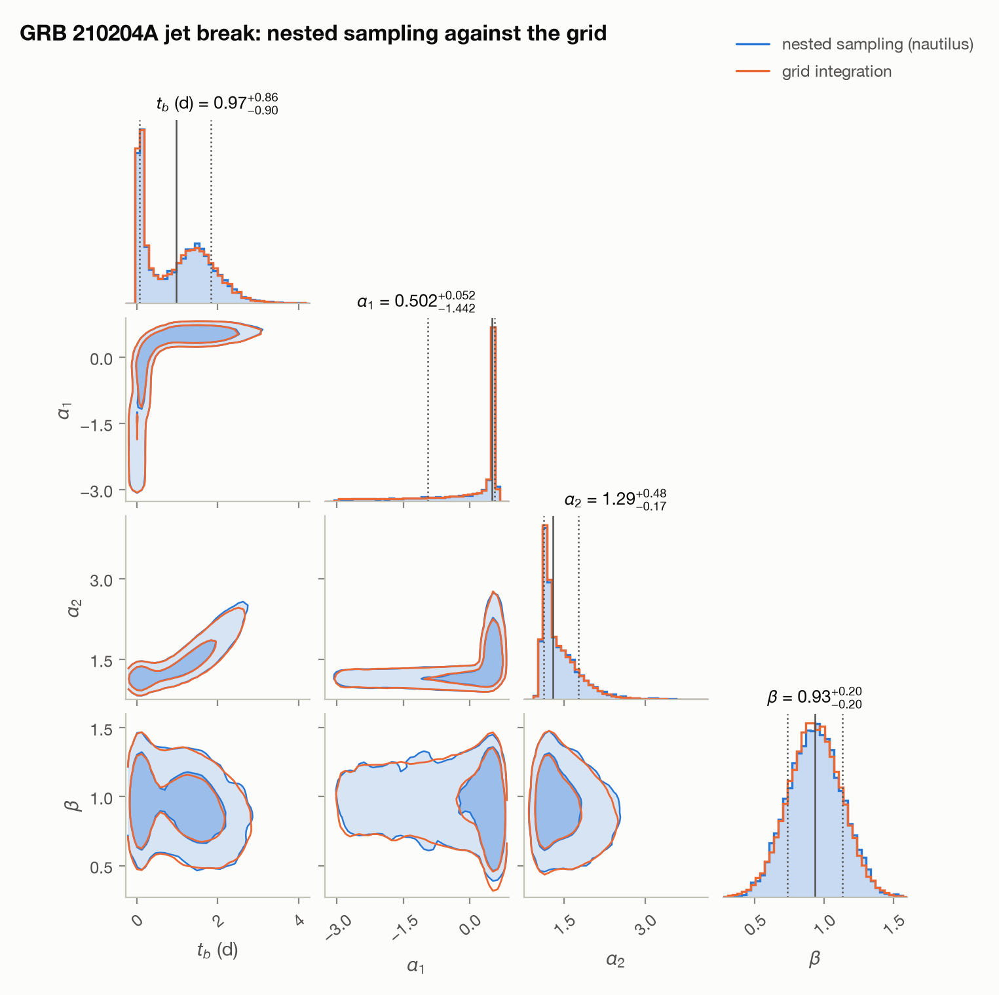
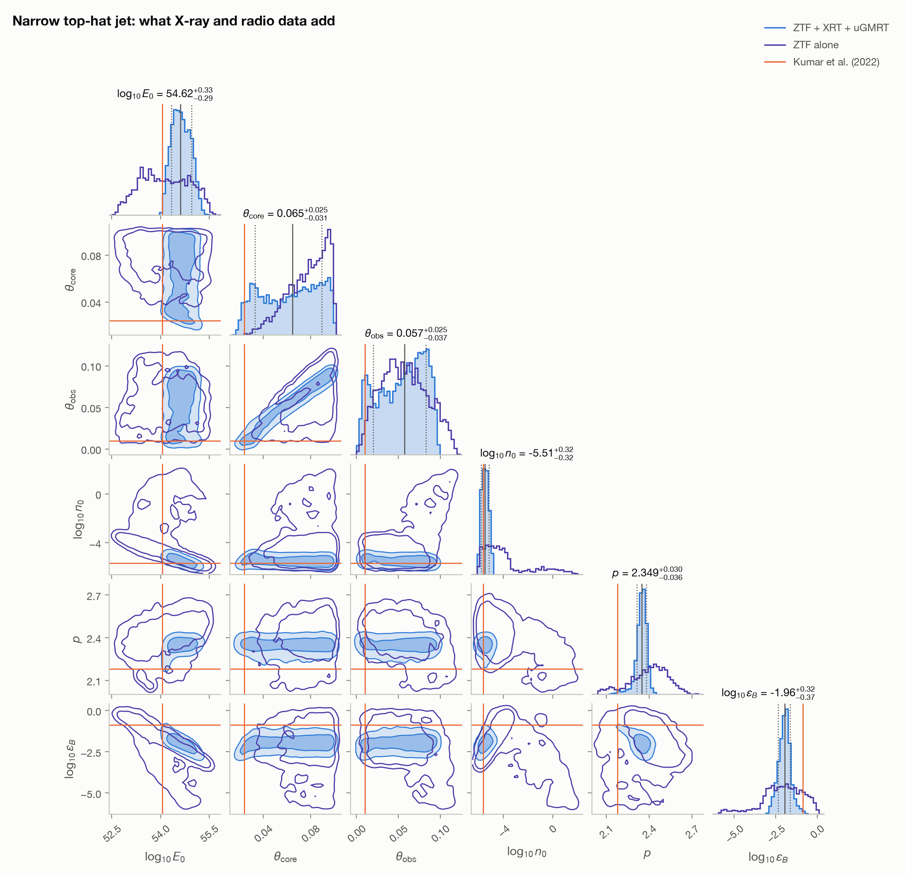
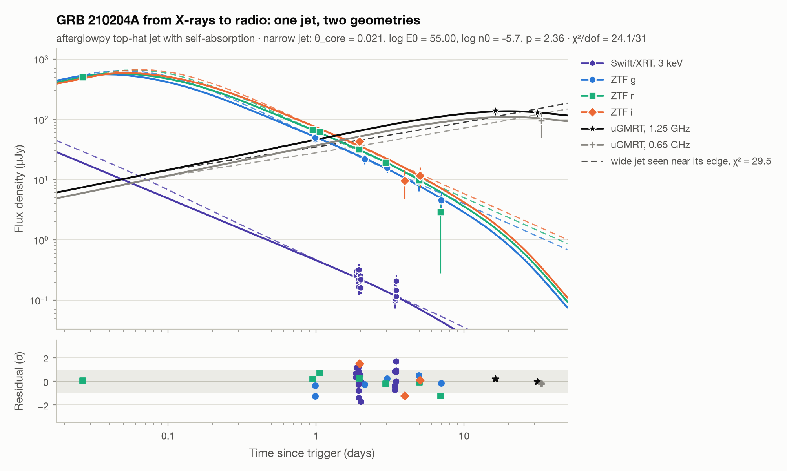
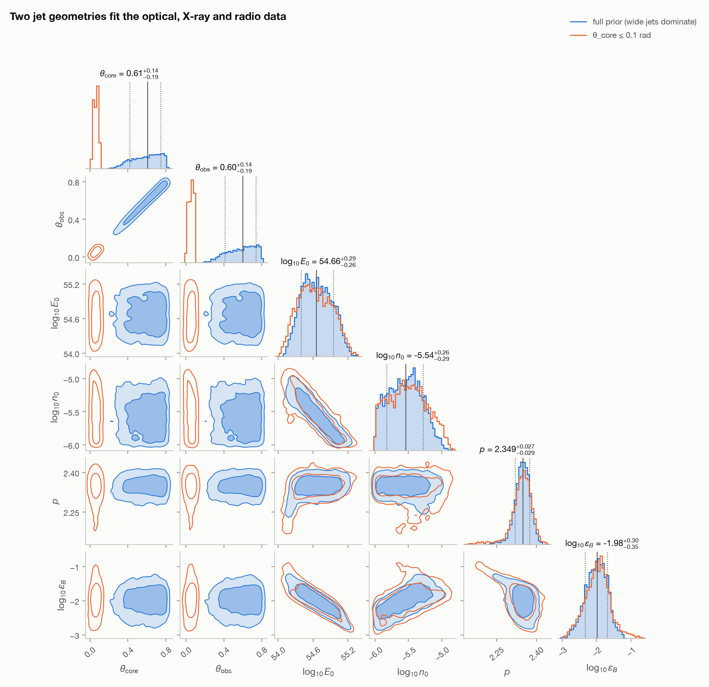

# Case study: GRB 210204A, an afterglow ZTF found itself

GRB 210204A was a long burst detected by Fermi/GBM on 2021 February 4. Its
coarse gamma-ray localisation would have made the afterglow hard to find, but
the Zwicky Transient Facility's survey happened to image the field 38 minutes
later and caught it at r = 17.1 (ZTF21aagwbjr, GCN Circular 29405). ZTF kept
observing the field in g, r and i for a month. At redshift 0.876 it is also
known for some of the most delayed optical flares ever seen in an afterglow
([Kumar et al. 2022](https://arxiv.org/abs/2204.07587)).

Unlike GRB 221009A, this field is far from the Galactic plane
(E(B−V) = 0.028), so ZTF's three bands measure the spectral index directly.

```bash
python case_studies/grb210204a/analyze.py      # runs offline on the committed data (~2 minutes)
python case_studies/grb210204a/fetch_data.py   # optional: rebuild data/ from IRSA and MAST
python case_studies/grb210204a/fetch_xray.py   # optional: rebuild data/swift_xrt.csv from the UK Swift Science Data Centre
```

## Method

1. All 47 public ZTF images from two days before to 40 days after the
   trigger (field 515, CCD 5, quadrant 1; 30 s exposures) go through
   `grb_afterglow.reduce_frame` with the deep ZTF reference image of each band
   as the template: difference imaging and empirical-PSF photometry, with zero
   points from Pan-STARRS1. Two frames have too few calibration stars.
2. ZTF and Pan-STARRS1 bandpasses differ, so each band's zero point has a
   colour term. It is measured once per band, as the median of the per-frame
   fits over all frames, and applied at the afterglow's own colour (computed
   from its spectral index): g −0.081 ± 0.020 and r +0.068 ± 0.025 per
   magnitude of g − r, i +0.151 ± 0.032 per magnitude of r − i.
3. The light curve is corrected for the Galactic extinction (Schlafly &
   Finkbeiner 2011, CCM89 curve) and a smoothly broken power law with a common
   spectral index is fitted jointly to g, r and i before 7 days, where the late
   flares begin. The posterior is integrated on a grid of break time and early
   decay index (`grb_afterglow.mcmc.grid_posterior`; see below for why not
   MCMC).

## Results

<picture>
  <source media="(prefers-color-scheme: dark)" srcset="figures/lightcurve_dark.png">
  
</picture>

<picture>
  <source media="(prefers-color-scheme: dark)" srcset="figures/subtraction_dark.png">
  
</picture>

The afterglow is detected above 3σ in 12 frames, from 0.6 hours to 5 days.
The discovery image gives r = 17.15 ± 0.03 (502 ± 15 µJy), in agreement with
the r = 17.11 of the discovery circular.

| | This pipeline (ZTF only, posterior median and 68 %) | Kumar et al. (2022) |
|---|---:|---:|
| Preferred model | broken power law (ΔBIC = 83 over a single one) | jet break |
| Early decay, alpha1 | 0.50 +0.05 −1.46 | ≈ 0.33 |
| Break time | 0.95 ± 0.88 d (two modes, below) | 0.37 ± 0.30 d |
| Late decay, alpha2 | 1.28 +0.47 −0.16 | 1.18 ± 0.03 |
| Spectral index, beta | 0.93 ± 0.19 | ≈ 0.75 (optical to X-ray) |
| Closure relation after the break | ISM, ν_m < ν < ν_c, p = 2.86 ± 0.38 (0.3σ) | ISM, p ≈ 2.5 |

The survey saw the afterglow once, at 0.6 hours, and then not until
0.94 days. That leaves two ways to place the break, and the posterior has a
mode for each:

- **A break between 1 and 2 days**, with an early decay of 0.50 set by the
  first point. This is the least-squares solution: t_b = 1.46 ± 0.45 d,
  alpha2 = 1.51 ± 0.27.
- **A break right after the first point.** Everything after it is then a
  single power law with alpha ≈ 1.2, and the first point says nothing about
  the early decay, which can take any value its prior allows. This mode holds
  40 % of the probability (break before 0.5 d). How much depends on the prior
  range of alpha1, uniform from −3 to 6 here: the data alone cannot choose
  between the two.

Kumar et al.'s break at 0.37 d, from denser data, lies between the modes. The
late decay, spectral index and electron index agree with theirs within 1σ. Their light curve combines ZTF with several other telescopes and
constrains the late decay far better. The spectral index from ZTF's three
bands and the closure relations independently point to the same
constant-density medium and electron index that Kumar et al. infer from the
optical and X-ray data.

**Why a grid, not MCMC.** An ensemble MCMC sampler mixes badly on this
posterior: the early-break mode is a long, thin funnel. Its autocorrelation
time grew with the length of the chain, from about 200 steps in a 6,000-step
chain to about 2,000 in a 30,000-step one. Version 0.4 of this case study
quoted t_b = 1.3 +0.7 −0.8 d from such an unconverged chain. The posterior is
therefore integrated on a grid instead:

- the grid covers break time and early decay index;
- amplitude, late decay and spectral index are integrated as Gaussians at
  each grid point;
- the result is unchanged on a grid twice as fine.

<p align="center">
<picture>
  <source media="(prefers-color-scheme: dark)" srcset="figures/posterior_dark.png">
  
</picture>
</p>

**The same posterior by nested sampling, and the evidence for the break.**
`nested_break.py` samples the jet-break fit with nested sampling
(`grb_afterglow.nested`, using `nautilus`), which needs no grid. It finds both
modes on its own and agrees with the grid integration:

| 68 % intervals | Nested sampling | Grid |
|---|---:|---:|
| Break time (d) | 0.97 [0.07, 1.84] | 0.95 [0.07, 1.82] |
| Early decay, alpha1 | 0.50 [−0.94, 0.55] | 0.50 [−0.96, 0.55] |
| Late decay, alpha2 | 1.29 [1.13, 1.77] | 1.28 [1.12, 1.75] |
| Spectral index, beta | 0.93 [0.74, 1.13] | 0.93 [0.74, 1.12] |
| P(break before 0.5 d) | 0.39 | 0.40 |

Nested sampling also returns the evidence of each model. The broken power law
has ln Z = −55.42 ± 0.01 and the single one −95.19 ± 0.01, a Bayes factor of
ln B = 39.8 (10¹⁷ to 1) for the break. The ΔBIC of 83 says the same; the
evidence gets there by averaging over the whole posterior, including the
early-break mode, instead of from the best fit alone.

```bash
pip install -e ".[nested]"
python case_studies/grb210204a/nested_break.py --n-jobs 3   # about 11 minutes of sampling
```

<p align="center">
<picture>
  <source media="(prefers-color-scheme: dark)" srcset="figures/nested_break_dark.png">
  
</picture>
</p>

**The late flares.** Kumar et al. report optical flares at 8.8 and 12.7 days.
The five ZTF points between 8 and 14 days lie on average 1.8 ± 1.9 µJy above
the extrapolated power law: consistent with flares of the published size, but
ZTF's 30 s exposures are not deep enough to detect them on their own.

<picture>
  <source media="(prefers-color-scheme: dark)" srcset="figures/filmstrip_dark.png">
  
</picture>

Per-epoch measurements are in [`results/ztf_photometry.csv`](results/ztf_photometry.csv)
and every number above in [`results/summary.json`](results/summary.json).

## A physical model of the jet

Kumar et al. fitted a top-hat jet with `afterglowpy` to radio, X-ray and
optical data. `physical_model.py` fits the same model to the ZTF light curve
alone, before 8 days:

```bash
pip install -e ".[models]"
python case_studies/grb210204a/physical_model.py   # ~20 minutes, mostly MCMC
```

<picture>
  <source media="(prefers-color-scheme: dark)" srcset="figures/physical_model_dark.png">
  
</picture>

**Their model against our photometry.** Kumar et al.'s posterior medians,
evaluated at the ZTF epochs, give chi² = 58 for 16 points. The shape matches,
but the ZTF fluxes are 16 % (0.17 mag) brighter. With that single scale
factor, chi² = 16 for 16 points. Their paper does not state a cosmology; the
distance here is from Planck 2018.

**What ZTF alone measures.** The density, epsilon_B and viewing angle are held
at Kumar et al.'s values, epsilon_e = 0.1 and xi_N = 1 as they had them, and
the energy, opening angle and electron index are fitted. The posterior medians
and 68 % intervals are:

| | ZTF only, this pipeline | Kumar et al. (2022) |
|---|---:|---:|
| Electron index, p | 2.16 +0.02 −0.01 | 2.18 ± 0.03 |
| Jet half-opening angle, θ_core (rad) | 0.022 +0.002 −0.004 | 0.024 +0.003 −0.002 |
| Energy, log10 E0 (erg) | 54.16 +0.02 −0.02 | 54.06 ± 0.03 |
| chi²/dof | 10.2/13 | |

The electron index and the opening angle agree. The energy is 0.1 dex
higher, which absorbs the 16 % offset in flux.

The posterior has a tail toward narrower jets. Its autocorrelation time
(about 140 steps) is longer than the emcee guideline allows for this chain
(16 walkers × 8,000 steps). An independent shorter run gave the same intervals
to within 0.01.

<p align="center">
<picture>
  <source media="(prefers-color-scheme: dark)" srcset="figures/physical_posterior_dark.png">
  
</picture>
</p>

**What it cannot measure.** With the density fixed and epsilon_B free as well,
two densities 50 times apart fit equally well:

| Density n0 (cm⁻³), fixed | log10 E0 | θ_core | p | log10 epsilon_B | chi²/dof |
|---|---:|---:|---:|---:|---:|
| 10⁻⁵·⁶⁷ (Kumar et al.) | 55.1 ± 0.3 | 0.023 ± 0.005 | 2.43 ± 0.22 | −2.8 ± 0.6 | 7.7/12 |
| 10⁻⁴ | 53.3 ± 0.2 | 0.049 ± 0.007 | 2.40 ± 0.15 | −1.0 ± 0.5 | 7.7/12 |
| 10⁻² | | | | | 210/12 |

The energies differ by a factor of 50 and the opening angles by 2, and the
electron index is now 2.4. A light curve in three optical bands measures two
slopes and a break, and those leave energy, density, epsilon_B and p trading
off against each other. Kumar et al. break the degeneracy with their X-ray and
radio data. Only the dense case, 10⁻² cm⁻³, fails to fit at all.

## Adding X-ray and radio data

`broadband_model.py` fits the same jet to three windows of the spectrum at
once, with six parameters free (energy, opening angle, viewing angle,
density, p and epsilon_B; epsilon_e = 0.1 and xi_N = 1 fixed as in Kumar et
al.), and samples the posterior by nested sampling:

- **ZTF g, r, i** before 8 days, as above (16 points, 2 % error floor).
- **Swift/XRT**: 19 bins between 1.9 and 3.5 days from the UK Swift Science
  Data Centre (`fetch_xray.py`), turned into the unabsorbed flux density at
  3 keV with the time-averaged spectrum (photon index 1.72). At 3 keV the
  conversion hardly depends on the uncertain absorption. Its remaining
  uncertainty is the same for every point, so it is one calibration offset
  with a 0.1 mag prior. The data do not constrain it further: its posterior,
  −0.01 ± 0.10 mag, is the prior.
- **uGMRT** at 1.25 and 0.65 GHz, 16 to 33 days: the three detections in
  Kumar et al.'s Table A4, with a 15 % floor for the flux scale and
  interstellar scintillation (an assumption: the paper does not say whether
  its errors include them).

`afterglowpy`'s spectrum leaves out synchrotron self-absorption, so the model
adds it, with the self-absorption frequency of Granot & Sari (2002). It turns
out not to matter here: the posterior puts that frequency at 3 to 12 MHz
(95 %), far below the radio bands.

```bash
pip install -e ".[models,nested]"
python case_studies/grb210204a/broadband_model.py --n-jobs 12   # about 80 minutes of sampling
```

**What X-ray and radio data add.** Within jets narrower than 0.1 rad, the
family Kumar et al. found, the posterior from all three wavebands against
the one from ZTF alone (medians and 68 % intervals):

| | ZTF alone | ZTF + XRT + uGMRT | Kumar et al. (2022) |
|---|---:|---:|---:|
| log10 E0 (erg) | 54.1 +0.9 −0.8 | 54.62 +0.33 −0.29 | 54.06 ± 0.03 |
| log10 n0 (cm⁻³) | −4.4 +3.2 −1.1 | −5.51 ± 0.32 | −5.67 +0.13 −0.16 |
| log10 epsilon_B | −2.0 ± 1.2 | −1.96 +0.32 −0.37 | −0.86 +0.17 −0.15 |
| Electron index, p | 2.42 +0.11 −0.15 | 2.349 +0.030 −0.036 | 2.18 ± 0.03 |
| θ_core (rad) | 0.080 +0.015 −0.021 | 0.065 +0.025 −0.031 | 0.024 +0.003 −0.002 |
| θ_obs (rad) | 0.056 +0.032 −0.028 | 0.057 +0.025 −0.037 | 0.010 ± 0.002 |

The 68 % intervals shrink by a factor of 6.7 in density, 3.3 in epsilon_B,
2.6 in energy and 4 in p. The density agrees with Kumar et al.'s. The energy,
epsilon_B and p do not, by 2 to 4 standard deviations. Kumar et al. fitted
more optical photometry, from several telescopes, and X-ray fluxes at 10 keV,
and the ZTF fluxes are 16 % brighter than their model (above). The intervals
here hold for these data and these error floors, not for the burst in
general.

<p align="center">
<picture>
  <source media="(prefers-color-scheme: dark)" srcset="figures/broadband_posterior_dark.png">
  
</picture>
</p>

**What they do not decide: the jet's geometry.** A second family of jets fits
all three wavebands as well: jets 0.3 to 0.8 rad wide (median 0.6), seen from
just inside their edge. The best fit of each family:

| | Narrow jet | Wide jet |
|---|---:|---:|
| θ_core, θ_obs (rad) | 0.021, 0.008 | 0.664, 0.660 |
| log10 E0, log10 n0, p | 55.0, −5.7, 2.36 | 54.5, −5.5, 2.36 |
| chi² ZTF / XRT / uGMRT | 7.9 / 16.2 / 0.1 | 11.8 / 15.9 / 1.8 |
| chi²/dof | 24.1/31 | 29.5/31 |
| Energy of the two jets, E0 (1 − cos θ_core) | 2.2 × 10⁵¹ erg | 6.9 × 10⁵³ erg |

The evidence of each family is almost the same: ln Z = −43.39 for the narrow
jets (θ_core up to 0.1 rad) and −43.06 for the wide ones, a Bayes factor of
ln B = −0.33 ± 0.01 (narrow against wide). The data have no preference.
Under the default prior, uniform in θ_core up to π/2, the wide family holds
96 % of the posterior simply because it spans 94 % of that prior. The wide
jets' θ_core and θ_obs run up to the 0.8 rad upper bound of the θ_obs prior
(95 % upper limits 0.80 and 0.79), so their width and their evidence hold
for that bound. In both families θ_obs rises in step with θ_core, and the
isotropic-equivalent energy, density, epsilon_B and p come out the same.
What would tell the two apart is the jet's true energy, E0 (1 − cos θ_core):
the best wide jet needs about 300 times more than the best narrow one. So
would earlier X-ray data, or deeper optical and radio data after about 10
and 30 days, where the two models part (the ZTF points after 8 days are left
out because of the flares, and are too faint to tell the two apart):

<picture>
  <source media="(prefers-color-scheme: dark)" srcset="figures/broadband_lightcurve_dark.png">
  
</picture>

<p align="center">
<picture>
  <source media="(prefers-color-scheme: dark)" srcset="figures/broadband_geometry_dark.png">
  
</picture>
</p>

Every number above is in [`results/broadband_model.json`](results/broadband_model.json).

## Limitations

- **One epoch before the break.** The ZTF survey visited the field 0.6 hours
  after the burst and then not until 0.94 days, so the break time and the early
  slope rest on a single point and their posterior depends on the priors.
- **Survey depth.** After about 5 days the afterglow falls below the depth of
  30 s ZTF exposures; around the full moon at 21 to 25 days the frames are almost
  two magnitudes shallower and have few calibration stars.
- **Few X-ray and radio points.** Swift/XRT observed for two days and the
  radio detections are three. The X-ray bins hold 15 to 34 counts each,
  where a Gaussian likelihood is only approximate, and the radio errors are
  taken as 1σ, which the paper does not state.
- **No host galaxy** is detected at the position, so the reference images
  contain only field stars; the subtraction is still needed for them and for
  the zero-point consistency between epochs.
