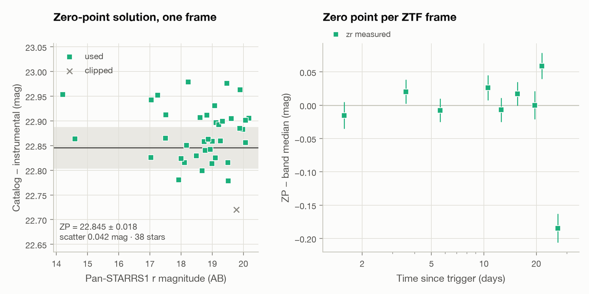

# Case study: GRB 221009A in public ZTF images

GRB 221009A, the "brightest of all time", went off on 2022 October 9 close to
the Galactic plane. Its optical afterglow sits behind several magnitudes of
dust in a crowded star field: a hard target for simple aperture photometry,
and a good test of whether this pipeline holds up on real data.

This case study runs the pipeline, unchanged, on the public Zwicky Transient
Facility (ZTF) survey images of the field and compares the result with
independent Liverpool Telescope photometry published by
[Laskar et al. (2023)](https://doi.org/10.3847/2041-8213/acbfad).

```bash
python case_studies/grb221009a/analyze.py      # runs offline on the committed data
python case_studies/grb221009a/fetch_data.py   # optional: rebuild data/ from IRSA and MAST
```

## Data

- **ZTF**: every public image covering the burst from one day before to 40
  days after the trigger (field 590, CCD 11, quadrant 4; 30 s exposures), as
  120″ cutouts, plus the deep ZTF reference image in each band. IRSA serves
  22 of the 27 epochs it lists.
- **Pan-STARRS1 DR1** stars within 1.6′, for the zero points.
- **Liverpool Telescope** griz photometry from Table 2 of Laskar et al. (2023),
  for comparison and for the spectral index, with the system transmission
  curves of the Liverpool IO:O filters from the SVO Filter Profile Service.

Provenance and acknowledgements are in [`data/README.md`](data/README.md).

## Method

1. Each ZTF cutout goes through `grb_afterglow.reduce_frame`: background and
   source detection, seeing from isolated stars (typically within 0.1 px of
   the value in the ZTF header), WCS cross-match with Pan-STARRS1, and a
   per-frame zero point from empirical-PSF photometry of the matched stars,
   with a colour term (below).
2. The deep pre-burst ZTF reference image (16 frames co-added, FWHM 2.2 px) is
   used as the template: it is resampled onto each epoch's pixel grid,
   PSF-matched with a Bramich (2008) kernel, and subtracted, which removes the
   blended field stars and any host light. In the three detected epochs the
   seeing is better than in the reference, so the science image is the one
   convolved and the PSF model is carried through the same kernel.
3. The afterglow is measured on the difference image by a forced PSF fit at the
   Swift/UVOT position, with an error from identical fits at blank positions
   (convolution correlates the pixel noise).
4. Epochs are inspected in the cutout filmstrip below. The 8.6-day r-band
   image is rejected because a satellite trail crosses the aperture.
5. A single power law is fitted to the r-band data after one day, where the
   published light curve has already steepened (break at 0.40 ± 0.04 d).
6. For comparison, the v0.2 measurement is repeated: aperture photometry of
   each epoch minus the flux in the same aperture on the reference image
   (6.5 ± 1.0 µJy in r).
7. The optical spectral index comes from the Liverpool griz photometry after
   1.7 days: the Galactic extinction (E(B−V) = 1.32 ± 0.06, Schlafly &
   Finkbeiner 2011 as derived by Shrestha et al. 2023; Cardelli et al. 1989
   curve) is averaged over each IO:O filter's transmission curve for the
   fitted spectral index, and a power law with a common decay and spectral
   index is fitted jointly to the four bands, then sampled with MCMC. The
   systematic error is the change in beta for E(B−V) ± 0.06.
8. ZTF r and Pan-STARRS1 r are different bandpasses, and behind this much dust
   the afterglow (g − r = 1.34 for the measured beta) is far redder than the
   calibration stars. The colour term, 0.141 ± 0.010 per magnitude of g − r, is
   measured once as the median of the per-frame fits over all r frames, and
   each frame's zero point is evaluated at the afterglow's colour.

## Results

<picture>
  <source media="(prefers-color-scheme: dark)" srcset="figures/lightcurve_dark.png">
  
</picture>

<picture>
  <source media="(prefers-color-scheme: dark)" srcset="figures/subtraction_dark.png">
  
</picture>

Detections in ZTF r (difference imaging, PSF photometry, colour term), with
the v0.2 measurement for comparison:

| Days after trigger | Flux density (µJy) | AB mag | S/N | v0.2: aperture − reference (µJy) | v0.2 S/N |
|---:|---:|---:|---:|---:|---:|
| 1.58 | 78.4 ± 3.9 | 19.16 | 20.1 | 69.8 ± 4.9 | 14.1 |
| 3.57 | 21.8 ± 2.4 | 20.55 | 9.1 | 20.7 ± 3.3 | 6.4 |
| 5.61 | 15.3 ± 2.3 | 20.94 | 6.7 | 10.3 ± 2.9 | 3.6 |
| 10.56 | 10.9 ± 3.2 | 21.30 | 3.5 | 6.7 ± 3.5 | 1.9 |

| Fit (t ≥ 1 d, r band) | alpha | chi²/dof |
|---|---:|---:|
| ZTF only, difference imaging + PSF | 1.34 ± 0.09 | 6.5/7 |
| ZTF only, v0.2 (aperture − reference flux) | 1.53 ± 0.15 | 7.2/7 |
| Liverpool Telescope only (refitted here) | 1.40 ± 0.02 | 15.7/17 |
| ZTF + Liverpool | 1.40 ± 0.02 | 22.8/26 |
| Laskar et al. (2023), r′ after 0.40 d | 1.42 ± 0.01 | |

Image subtraction with PSF photometry raises the signal-to-noise of every
detection by a factor of 1.4 to 1.9, adds a fourth detection, and shrinks the
uncertainty of the ZTF-only decay index by 40 %; both methods agree with the
published value (0.9σ and 0.8σ), and refitting the Liverpool data with this
package's fitter reproduces the published index. At the first three ZTF
detections the ZTF magnitudes are within 0.19 mag of the Liverpool power law
(−0.03, +0.11, −0.19 mag), comparable to the per-point errors (0.05 to
0.16 mag); the marginal 10.6-day point lies 1.7σ above it. The colour term
makes the afterglow 2 to 3 % brighter than a zero point at the stars' average
colour would; the remaining differences are within the errors, and ZTF r and
the Liverpool r′ filter are still different bandpasses.

### The spectral index behind the Galactic plane

<picture>
  <source media="(prefers-color-scheme: dark)" srcset="figures/sed_dark.png">
  
</picture>

The Galactic dust removes 4.7 magnitudes in g and 2.0 in z: as observed, the
spectrum would imply beta = 4.35. Removing E(B−V) = 1.32 gives

| | beta |
|---|---:|
| This analysis, Liverpool griz after 1.7 d | 0.41 ± 0.06 (stat) ± 0.18 (E(B−V)) |
| O'Connor et al. (2023), optical/IR after 1.7 d, same E(B−V) | 0.68 ± 0.05 |

which agree at 1.4σ. The systematic error dominates: at this extinction a
±0.06 change in E(B−V) moves beta by ±0.18. The details of the correction
matter at the same level: with SDSS instead of the actual IO:O pivot
wavelengths, or with the extinction evaluated at the pivot instead of
averaged over each filter, beta comes out 0.08 lower each time. The posterior
of the decay and spectral indices is in
[`figures/posterior_light.png`](figures/posterior_light.png). With beta this
uncertain the closure relations cannot single out an emission regime: three
of them agree with alpha = 1.37 within 1.5σ.

<picture>
  <source media="(prefers-color-scheme: dark)" srcset="figures/filmstrip_dark.png">
  
</picture>

<picture>
  <source media="(prefers-color-scheme: dark)" srcset="figures/zeropoints_dark.png">
  
</picture>

Per-epoch measurements are in [`results/ztf_photometry.csv`](results/ztf_photometry.csv)
and the numbers above in [`results/summary.json`](results/summary.json).

## Limitations

- **Survey cadence.** ZTF's public survey visits the field every two to
  three nights with 30 s exposures, so the afterglow is detected only three
  times before it fades below about r = 21.5.
- **Calibrating the difference image.** The reference image has worse seeing
  than the detected epochs, so the difference image carries the reference's
  PSF and its flux scale has to be tied back to the science image's zero
  point. The obvious shortcut, an aperture correction from the curve of
  growth of stars in the deep reference, fails here: in this crowded field,
  neighbouring stars inside the large "total" apertures inflate it, and the
  fluxes came out twice too high. The pipeline instead carries the science
  PSF through the matching kernel (see
  [`docs/science_background.md`](../../docs/science_background.md)).
- **The spectral index is limited by the dust.** E(B−V) toward this
  low-latitude field is itself uncertain (Shrestha et al. 2023 discuss values
  from 0.71 to 1.32), and the correction assumes Milky Way dust with
  R_V = 3.1. Near-infrared photometry, far less affected by the dust, would
  constrain beta much better than griz alone.
- **g band.** The g-band frames are too shallow for a detection given the
  extinction, and several have too few calibration stars to be calibrated.
