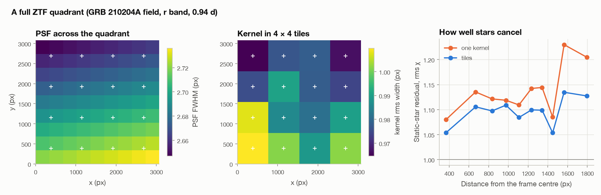

# A full ZTF quadrant with a PSF and kernel that vary across the frame

The case studies measure afterglows on 120″ cutouts, over which the PSF is
effectively constant. This script runs the pipeline on a whole CCD quadrant
instead. It uses the same GRB 210204A epoch as the case study (r band, 0.94 d
after the burst; field 515, CCD 5, quadrant 1; 3072 × 3080 pixels, 0.86 × 0.87
degrees) with `PipelineConfig(photometry="psf", tiles=(4, 4))`:

- the PSF varies smoothly over the frame;
- the subtraction kernel is fitted in 16 tiles;
- the zero point comes from every Pan-STARRS1 star on the quadrant.

```bash
python dev/full_frame/run_full_frame.py   # downloads ~80 MB into dev/full_frame/data on the first run
```

<picture>
  <source media="(prefers-color-scheme: dark)" srcset="full_frame_dark.png">
  
</picture>

| | Full quadrant, 4 × 4 tiles | 120″ cutout (case study) |
|---|---:|---:|
| Afterglow flux at 0.94 d | 68.4 ± 4.4 µJy | 67.9 ± 3.8 µJy |
| Zero-point stars | 4,650 | 6 |
| Sources detected | 5,843 | |
| Run time on a laptop | 11 minutes | |

The two measurements agree to 0.1σ. The full frame calibrates the burst
against nearly eight hundred times as many stars, so it does not depend on the
handful of stars that happen to lie near it.

**The PSF across the quadrant.** The model is built from 620 PSF stars.

- Its FWHM ranges from 2.65 to 2.74 px across the frame, a variation of 3 %,
  larger at the bottom.
- The ellipticity changes significantly as well.
- The Moffat index changes only along x, and the width only along y.

These are the gradients that pass the 3σ significance test; the others are set
to zero.

**The kernel and static stars.** The tile kernels follow the PSF: they are
widest where the science PSF is widest. Within 1.5 FWHM of 2,462 bright
stars, the median normalised residual is χ = 1.14 with one kernel for the
whole quadrant and 1.09 with 4 × 4 tiles. The single kernel does worst far
from the centre, where its PSF match is poorest. On this quadrant the seeing
varies little, so the gain is modest. On frames where it varies more, the
synthetic tests show residuals falling from 6σ to about 2σ (`tests/test_spatial.py`).

Numbers are in [`results.json`](results.json). The downloaded data (`data/`)
are not committed.

## Method

1. Detection, seeing and cross-matching run on the whole frame, against
   Pan-STARRS1 stars brighter than r = 19.5 within 38′ of the quadrant centre.
2. **PSF** (`build_spatial_psf`):
   - Every tile, with a margin, is fitted as a scene to subtract neighbours and
     select PSF stars.
   - A Moffat profile whose parameters are planes in position is fitted to
     the PSF stars of all tiles together.
   - A gradient is kept only if it is significant.
   - Stars and the burst are then measured tile by tile, each with the PSF at
     its own position (`psf_photometry_tiled`).
3. **Subtraction** (`subtract_images(..., tiles=(4, 4))`):
   - A kernel and background are fitted in every tile, using the pixels near
     stars plus a sample of sky.
   - The kernel at any pixel is the bilinear interpolation of the tile kernels.
   - The burst is measured with the PSF and kernel at its position.
